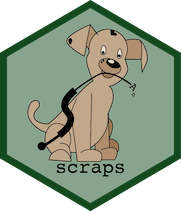
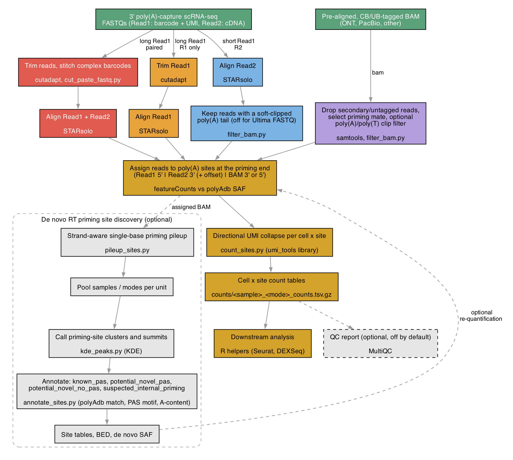
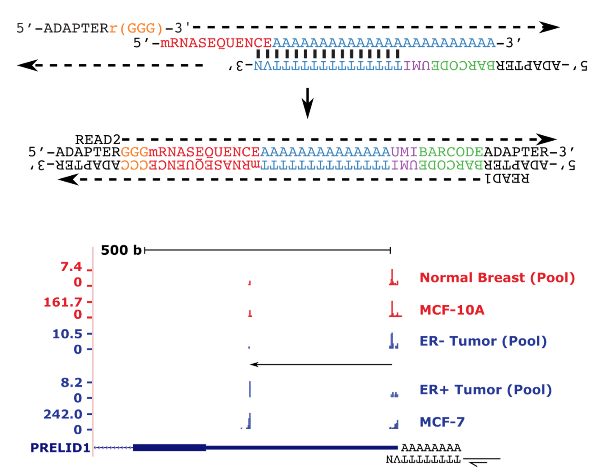
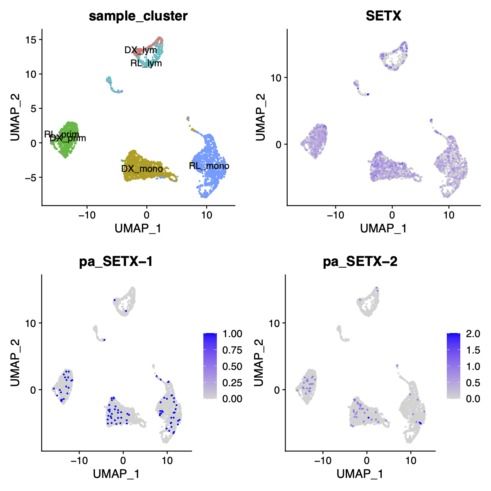
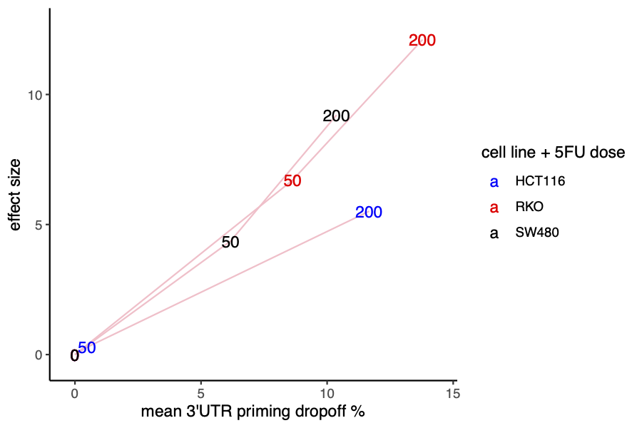

# scraps 

<!-- badges: start -->


<!-- badges: end -->

### scraps extracts mRNA polyadenylation sites from "TVN"-primed single-cell RNA-seq libraries at near-nucleotide resolution.

scraps (**S**ingle **C**ell **R**N**A** **P**olyA **S**ite Discovery) is currently implemented as a <a href="https://snakemake.readthedocs.io/en/stable/">Snakemake</a> pipeline for 
10X Genomics 3' end v2/v3/v4 libraries (and other platforms with similar library structure, including Drop-seq, 
Microwell-seq, and BD Rhapsody), sequenced on Illumina, Element or Ultima instruments, as well as pre-aligned,
barcode-tagged BAMs (e.g. ONT / PacBio long reads). If long Read1 is available (estimated ~6% of SRA-deposited data, or now planning new experiments), positional information will be calculated from paired realignment; otherwise, the less optimal anchored Read2 approach is used. scraps will eventually be expanded for analyzing a range of RNA processing 
changes in single-cell RNA-seq data.

For additional discussions and usage cases, please see [bioRxiv preprint](https://www.biorxiv.org/content/10.1101/2022.08.22.504859v1).



---
-   [Example usage](#example-usage)
-   [Configuration](#configuration)
-   [Supported scRNA-seq platforms](#supported-scrna-seq-platforms)
-   [Output](#output)
-   [De novo priming site discovery](#de-novo-priming-site-discovery)
-   [Setup](#setup)
-   [Dependencies](#dependencies)
-   [For Developers](#for-developers)
-   [Extended function](#extended-function)
    
## Example usage

scraps requires the following as input (defined in config.yaml):

  - 10X Genomics 3' v2/v3/v4 single-cell FASTQs or other platforms. FASTQs are located by the glob `{DATA}/{basename}*R1*`; the mate file is the same path with `R1` replaced by `R2`. All matching files (e.g. multiple lanes) are concatenated, files must be gzipped, and `basename` may be a list. Avoid basenames that are prefixes of another sample's basename, and avoid `R1` elsewhere in the path. Alternatively, a pre-aligned BAM (see [Pre-aligned BAM input](#pre-aligned-bam-input)).
  - A STAR genome index (must be generated with STAR 2.7.4a and above); not needed for BAM input
  - Whitelist for cell barcodes (required for the 10x chemistries as configured in `chemistry.yaml`; set `bc_whitelist: None` to run without one)
  - A featureCounts reference (SAF-formatted <a href="http://exon.umdnj.edu/polya_db/">polya_db</a>, hg38 and mm10 files are included in [ref](https://github.com/rnabioco/scraps/tree/master/ref) subdirectory; converters for polyAdb 3.2 and 4 are in [inst/scripts/polyadb/](inst/scripts/polyadb/))

### Quick Start

1. Set up conda environment:
```bash
conda env create -f scraps_conda.yml
conda activate scraps_conda
```

2. Configure your samples in `config.yaml` under the `SAMPLES` section

3. Run the pipeline:
```bash
snakemake -j 24 --resources total_impact=5 --keep-going
```

### Detailed Usage

To run the bundled test samples (after downloading the STAR index and whitelists from [Setup](#setup); the dry-run-only fixtures `chromiumv3_ultima_fastq_test` and the `bam_*_test` samples in `config.yaml` should be removed from `SAMPLES` first, since they have no FASTQs / only a synthetic BAM):
```
snakemake --snakefile Snakefile \
  -j 24 \
  --resources total_impact=5 \
  --keep-going
```
`config.yaml` is read automatically (`configfile:` in the Snakefile). To pass a different one, use `--configfile other.yaml`; put any explicit target *before* that flag, because `--configfile` accepts multiple files.

[DAG steps illustration](https://raw.githack.com/rnabioco/scraps/master/inst/dag.pdf) (rule graph of all four alignment modes with discovery enabled)

**Cluster execution (SLURM)**: either run the whole pipeline inside one batch allocation with the command above, or submit each rule as its own SLURM job with the bundled profile (set your account and partition in [`profiles/slurm/config.v8+.yaml`](profiles/slurm/) first):
```
snakemake --profile profiles/slurm --configfile config.yaml
```
See [profiles/slurm/README.md](profiles/slurm/README.md) and the [SLURM executor plugin docs](https://snakemake.github.io/snakemake-plugin-catalog/plugins/executor/slurm.html). Other schedulers use their own [executor plugins](https://snakemake.github.io/snakemake-plugin-catalog/index.html) (`--executor <name>`); Snakemake 8+ no longer has `--cluster`/`--drmaa`.

Notes: each STAR alignment job (one per sample × alignment mode) uses `total_impact=5`; `--resources total_impact=5*N` allows N concurrent STAR jobs.

STAR memory: each STARsolo job requests the genome index size (read from `STAR_INDEX`) plus a 16 GB BAM-sort buffer and 4 GB headroom, and `--limitBAMsortRAM` is derived from that request, so sorting stays inside the allocation. For large libraries set `STAR_mem_mb` (MB) in `DEFAULTS`, a platform block, or a sample block, or override `mem_mb` with `set-resources`/`--set-resources`; the sort buffer follows either way. The SLURM profile retries a failed job once, and STAR jobs get twice the memory on the retry.

---

## Configuration

scraps uses two main configuration files for flexible pipeline setup:

### config.yaml

Main pipeline configuration file containing:

- **DATA**: Directory containing input FASTQ files (and BAMs given by a relative `bam:` path)
- **RESULTS**: Output directory for pipeline results
- **STAR**: STAR executable (default `STAR`, i.e. from `PATH`)
- **STAR_INDEX**: Path to the extracted STAR genome index directory
- **POLYA_SITES**: PolyA site reference (SAF format, provided in `ref/`; a file not ending in `.saf`/`.saf.gz` is passed to featureCounts as GTF)
- **GENOME_FASTA**: Genome FASTA (with `.fai`), required only for de novo priming site discovery
- **DISCOVERY**: Optional de novo RT priming site discovery settings (see [docs/discovery.md](docs/discovery.md))
- **DEFAULTS**: Lowest-priority values for any per-sample / chemistry key
  - `platform`: Default sequencing platform (illumina, element, ultima_cram, ultima_fastq, generic; availability depends on the chemistry, see `chemistry.yaml`)
  - `chemistry`: Default chemistry type (e.g., chromiumV3, chromiumV4, chromiumV2, dropseq)
  - `alignments`: Which alignment modes to run ([R1, R2, paired, bam])
  - `R2_polyA_filter`, `R2_priming_offset`, `bam_mate`, `bam_strand`, `bam_polyA_filter`, `bam_priming_offset`: mode switches (see [chemistry.yaml](#chemistryyaml) and [Pre-aligned BAM input](#pre-aligned-bam-input))
- **SAMPLES**: Per-sample configuration (`basename` or `bam`, `chemistry`, `platform`, `alignments`, `discovery_read`, plus any chemistry/platform key such as `STAR_R2` or `STAR_R2_extra_args` to override it for that sample)
- **report_section_order**: MultiQC section order (only used by the optional `qc_check` rule)

#### Sample Configuration Example:
```yaml
SAMPLES:
  sample_name:
    basename: sample-           # FASTQ file prefix
    platform: illumina          # Sequencing platform
    chemistry: chromiumV3       # Platform chemistry
    alignments:                 # Optional: override default alignments
      - R2
      - paired
```

### chemistry.yaml

Platform and chemistry-specific parameters organized hierarchically. Each chemistry type (chromiumV3, chromiumV4, chromiumV2, ddseq, dropseq, microwellseq, bd, indrop) contains:

- **bc_whitelist**: Path to barcode whitelist file (`None` to run without one)
- **bc_cut** / **bc_length1**: Adapter sequences (and R1 barcode length) for complex barcode extraction (optional; ddseq, microwellseq, bd)
- **Platform-specific settings**: Nested configurations for different sequencing platforms. Not every platform exists under every chemistry: `element`, `ultima_cram` and `ultima_fastq` are defined for chromiumV3/V4, `generic` for chromiumV2/V3/V4, and the non-10x chemistries have `illumina` only.
  - `valid_modes`: Alignment modes the platform supports (`R1`, `R2`, `paired`, `bam`); other modes are rejected at parse time
  - `cutadapt_R1` / `cutadapt_paired`: Adapter trimming parameters (omit to skip trimming)
  - `STAR_R1` / `STAR_R2` / `STAR_paired`: STAR alignment parameters (UMI/barcode positions). `STAR_R1` feeds the single-mate R1-only rule, so its `--clip5pNbases` must have exactly **one** value; `STAR_paired` feeds the two-mate paired rule and takes **two** clip values (`<R1clip> 0`).
  - `R2_polyA_filter` (default `true`): require a soft-clipped poly(A) tail on R2 alignments. Set `false` for reads that cannot carry one (`ultima_fastq`).
  - `R2_priming_offset` (default `0`): bp to move the R2 alignment 3' end in the transcript 3' direction before site assignment and pileup. `ultima_fastq` uses `5` because Ultima trims the 5 bp adjacent to the poly(A) homopolymer.

### Configuration Hierarchy

The pipeline uses hierarchical configuration lookup to determine parameters for each sample:

```
┌─────────────────────────────────────────────────────────┐
│  1. Sample-specific settings (config.yaml SAMPLES)     │
│     Highest priority - overrides everything             │
└────────────────────┬────────────────────────────────────┘
                     │ If not found ↓
┌─────────────────────────────────────────────────────────┐
│  2. Chemistry + Platform (chemistry.yaml)               │
│     e.g., chromiumV3 → illumina → STAR_R1               │
└────────────────────┬────────────────────────────────────┘
                     │ If not found ↓
┌─────────────────────────────────────────────────────────┐
│  3. Chemistry defaults (chemistry.yaml)                 │
│     e.g., chromiumV3 → bc_whitelist                     │
└────────────────────┬────────────────────────────────────┘
                     │ If not found ↓
┌─────────────────────────────────────────────────────────┐
│  4. Global defaults (config.yaml DEFAULTS)              │
│     Lowest priority - fallback values                   │
└─────────────────────────────────────────────────────────┘
```

This allows platform-specific customization (e.g., Illumina vs Ultima Genomics) while maintaining chemistry-specific defaults.

---

## Supported scRNA-seq platforms
| Platform | Library (BC+UMI+A) | Setting | Test data |
| :--------|:------------| :------------| :---------|
| 10x Chromium V3 | [16 + 12 + 30](https://teichlab.github.io/scg_lib_structs/methods_html/10xChromium3.html) | chromiumV3 | (via the Ultima and synthetic BAM fixtures) |
| 10x Chromium V4 (GEM-X) | [16 + 12 + 30](https://teichlab.github.io/scg_lib_structs/methods_html/10xChromium3.html) | chromiumV4 | |
| 10x V3/V4 - Ultima Genomics, CRAM-derived reads | [adapter + 16 + 9 + 3 ignored + 8](https://www.nature.com/articles/s41587-022-01452-6/figures/1) | chromiumV3 / chromiumV4, `platform: ultima_cram` (R1 mode) | ✓ |
| 10x V3/V4 - Ultima Genomics, delivered FASTQs | R1 = 16 + 9, R2 = cDNA (pseudo-paired); priming site = R2 3' end + 5 bp | chromiumV3 / V4, `platform: ultima_fastq` (R2 mode) | |
| Pre-aligned BAM (ONT / PacBio long reads, or any compatible single- or paired-end BAM) | CB/UB-tagged, full-length molecules; see [Pre-aligned BAM input](#pre-aligned-bam-input) | any 10x chemistry, `platform: generic`, `alignments: [bam]` | ✓ (synthetic) |
| 10x Chromium V2 | [16 + 10 + 30](https://teichlab.github.io/scg_lib_structs/methods_html/10xChromium3.html) | chromiumV2 | ✓ |
| ddSEQ (Bio-Rad / Illumina SureCell) | 21 + 8 (after `bc_cut` linker removal) | ddseq | |
| Drop-seq | [12 + 8 + 30](https://teichlab.github.io/scg_lib_structs/methods_html/Drop-seq.html) | dropseq | ✓ |
| Microwell-seq | [6x3 + 6 + 30](https://teichlab.github.io/scg_lib_structs/methods_html/Microwell-seq.html) | microwellseq | ✓ |
| BD Rhapsody | [9x3 + 8 + 18](https://teichlab.github.io/scg_lib_structs/methods_html/BD_Rhapsody.html) | bd | |
| inDrop | [8 + 6 + 18](https://teichlab.github.io/scg_lib_structs/methods_html/inDrop.html) | indrop | |

Custom chemistry supported, by editing [chemistry.yaml](https://github.com/rnabioco/scraps/tree/master/chemistry.yaml). Also see synthetic FASTQ [tool](https://github.com/raysinensis/bc_umi_gen).

**Ultima Genomics notes.** Reads converted from Ultima CRAM files are one long read (adapter + CB + UMI + cDNA) and use `platform: ultima_cram` with `alignments: [R1]` (no cutadapt step). FASTQs delivered by Ultima for 10x libraries are instead pseudo-paired (R1 = cell barcode + UMI, R2 = cDNA) and use `platform: ultima_fastq` with `alignments: [R2]`. Because Ultima trims the 5 bp adjacent to the poly(A) homopolymer, `ultima_fastq` disables the soft-clipped poly(A) filter and shifts the priming site 5 bp downstream of the R2 alignment end (`R2_polyA_filter: false`, `R2_priming_offset: 5`). No detectable poly(A) is required for these reads at any step. The FASTQ file names must follow the usual `*_R1*` / `*_R2*` pattern.

### Pre-aligned BAM input

The `bam` alignment mode counts a BAM that was aligned and barcode-tagged elsewhere (ONT or PacBio long reads, or any compatible short-read BAM) without a STAR step. Use `platform: generic`, `alignments: [bam]`, and a per-sample `bam:` path (absolute, or relative to `DATA`); `basename` is not needed.

```yaml
SAMPLES:
  my_longread:
    bam: my_longread.tagged.bam
    chemistry: chromiumV3
    platform: generic
    alignments: [bam]
    # bam_strand: same        # see table
    # bam_polyA_filter: false
    # bam_mate: 0
```

Which end of the read is the priming site, and whether a poly(A)/poly(T) soft clip is required there, is declared per sample (defaults in `config.yaml` `DEFAULTS`):

| class | `bam_strand` | counted end | `bam_polyA_filter` | featureCounts |
|:--|:--|:--|:--|:--|
| 1 | `same` (read is on the transcript strand) | read 3' end | `false` | `-s 1 --read2pos 3` |
| 2 | `same` | read 3' end | `true` (3' poly(A) soft clip required, like R2) | `-s 1 --read2pos 3` |
| 3 | `reverse` (read is antisense) | read 5' end | `false` | `-s 2 --read2pos 5` |
| 4 | `reverse` | read 5' end | `true` (5' poly(T) soft clip required) | `-s 2 --read2pos 5` |

**Paired-end BAMs**: set `bam_mate: 1` or `2` to name the mate whose end is the priming site. Only proper pairs are kept, the other mate is dropped, and the selected mate is rewritten as a single-end record, so every fragment contributes one position. `bam_strand` and `bam_polyA_filter` then describe that mate (a 10x-style paired BAM is class 3 on mate 1). `bam_priming_offset` (bp the priming site lies beyond the counted end) works as for `R2_priming_offset`.

**Assumptions (documented, not enforced)**: the BAM contains full-length molecules (adapters at both ends), carries CellRanger/STARsolo-style tags (only `CB` and `UB` are read), and its strand assignment is accurate for the declared `bam_strand`. Reads without `CB`/`UB`, and secondary/supplementary alignments, are always dropped. featureCounts runs in long-read mode (`-L`, single-threaded) so spliced long reads keep their full CIGAR. The soft-clip filter only recognises `M`/`S` CIGAR operations; BAMs with `=`/`X` or hard clips (e.g. pbmm2, minimap2 `--eqx`) must use `bam_polyA_filter: false`.

---

## Output
1. Aligned BAMs: `{RESULTS}/{sample}/{sample}_{mode}_Aligned.sortedByCoord.out.bam` (STARsolo output with CB/UB tags; not produced for the `bam` mode)
2. Count table: `{RESULTS}/counts/{sample}_{mode}_counts.tsv.gz`, directional-UMI-collapsed counts per cell barcode for each `POLYA_SITES` feature (bundled hg38 SAF: a transcript-oriented -10/+5 bp window around each polyAdb cleavage site). GeneID fields are `;`-delimited for hg38 and `_`-delimited for mm10; overlapping features are comma-joined.
```
gene    cell    count
RPL26;6154;ENSG00000161970;chr17;8377421;-;3'UTR(L)     AACTCCCGTTCCTCCA        1
RPL26;6154;ENSG00000161970;chr17;8377421;-;3'UTR(L)     CCCATACGTTAAAGAC        1
ACTG1;71;ENSG00000184009;chr17;81509999;-;3'UTR(M)      ACATCAGGTGATGTCT        1
ADRM1;11047;ENSG00000130706;chr20;62308862;+;3'UTR(M)   CAGCGACTCTGCCCTA        1
```
3. (Discovery only) Strand-aware single-base priming pileups `{RESULTS}/discovery/beds/{sample}_{mode}.stranded.bed.gz` (chrom, start, end, UMI count, transcript strand) and the annotated site tables described under [De novo priming site discovery](#de-novo-priming-site-discovery).

4. Benchmarks: `{RESULTS}/benchmarks/<rule>_<sample>_<mode>.tsv` (discovery: `<rule>_<unit>.tsv`), Snakemake's per-job wall time, peak memory and CPU time for every rule. Summarize them per sample with `python3 inst/scripts/benchmark_summary.py {RESULTS}/benchmarks`.

A MultiQC report is not produced by default (the `qc_check` rule in `rules/qc.snake` is disabled in `rule all`); an [example report](https://raw.githack.com/rnabioco/scraps/master/inst/test_output/report/multiqc_report.html) from an earlier version is kept under `inst/test_output/`.

[R functions](https://github.com/rnabioco/scraps/tree/master/inst/scripts/R) available for importing results into Seurat object, and finding differential PA site usage; `source()` `inst/scripts/R/geneid.R` first (it provides the delimiter-aware GeneID parser the other files use; they also source it automatically when loaded with `source()`). These copies are authoritative: the separate [`scrapR`](https://github.com/rnabioco/scrapR) package (`remotes::install_github("rnabioco/scrapR")`, also in the Docker image) still carries the older `_`-only GeneID parsing and does not work with the `;`-delimited hg38 output.

<p float="left">
  
  
</p>

___

## De novo priming site discovery

By default scraps quantifies poly(A) usage against **validated** poly(A) sites
(polyAdb), which is the recommended reference for downstream quantitative
analyses. Optionally, scraps can also use its single-base resolution to
**discover RT priming sites de novo** and annotate them.

The discovery module (off by default) applies kernel density estimation to
pseudobulked, UMI-deduplicated, strand-aware single-base priming positions
(per sample, or per a defined group of samples), calls priming-site summits,
and classifies each as:

- **`known_pas`** — matches a validated polyAdb cleavage/polyA site
- **`suspected_internal_priming`** — the genomic sequence just downstream is
  A-rich. This is the signature of oligo-dT priming off a templated A-stretch,
  but genuine cleavage/polyadenylation sites also occur in and next to genomic
  A-tracts (as 3'READS+, which avoids internal priming, shows), so these sites
  cannot be resolved computationally
- **`potential_novel_pas`** — no A-rich signature plus a canonical poly(A)
  signal (PAS) motif upstream (a *candidate* requiring validation)
- **`potential_novel_no_pas`** — no A-rich signature and no PAS motif (a
  lower-confidence candidate)

> **Note:** discovered sites are for hypothesis generation. For quantitative
> analyses, use validated poly(A) sites. Both novel classes require orthogonal
> validation. `suspected_internal_priming` sites are ambiguous rather than
> artifacts: interpret them with caution, report results with and without them
> where it matters, and confirm with an orthogonal method before treating them
> as real sites.

Enable it by setting `GENOME_FASTA` and `DISCOVERY.enabled: true` in
`config.yaml`. Outputs are written to `{RESULTS}/discovery/` (annotated TSV, BED,
and a reusable de novo SAF per discovery unit, plus the per-(sample, mode)
stranded priming beds under `discovery/beds/`). See **[docs/discovery.md](docs/discovery.md)** for
the full method, configuration, caveats, and re-quantitation workflow.

___

## Setup

### 1. Clone repository
```bash
git clone https://github.com/rnabioco/scraps
cd scraps
```

### 2. Set up conda environment (recommended)
```bash
conda env create -f scraps_conda.yml
conda activate scraps_conda
```

Alternatively, ensure all [dependencies](#dependencies) are installed and available in your PATH.

### 3. Prepare reference files

#### STAR genome index
Place STAR index in the `ref/` directory or specify custom path in config.yaml (`STAR_INDEX` must point at the extracted index directory; the default is `ref/cr2020A_star/`). Not needed for BAM input.

Download link (extract after download):
- [GRCh38 index](https://scrapsaccessory.s3.us-west-2.amazonaws.com/GRCh38_cr2020A_star.tar.gz)

#### Barcode whitelists (required for the 10x chemistries as configured)
Whitelist paths are configured per chemistry in `chemistry.yaml` and passed to STARsolo `--soloCBwhitelist`, so a missing file fails the alignment; set `bc_whitelist: None` to run without one. Place downloaded whitelists in the `ref/` directory.

Download links (extract after download):
- [10x V2 barcodes](https://scrapsaccessory.s3.us-west-2.amazonaws.com/737K-august-2016.txt.gz) → `ref/737K-august-2016.txt`
- [10x V3 barcodes](https://scrapsaccessory.s3.us-west-2.amazonaws.com/3M-february-2018.txt.gz) → `ref/3M-february-2018.txt`
- 10x V4 (GEM-X 3') barcodes: `3M-3pgex-may-2023_TRU.txt.gz` from a Cell Ranger install (`lib/python/cellranger/barcodes/`) → `ref/3M-3pgex-may-2023_TRU.txt`

Update `chemistry.yaml` with the correct paths:
```yaml
chromiumV3:
  bc_whitelist: ref/3M-february-2018.txt
chromiumV4:
  bc_whitelist: ref/3M-3pgex-may-2023_TRU.txt   # 10x GEM-X 3' whitelist (shipped with Cell Ranger)
chromiumV2:
  bc_whitelist: ref/737K-august-2016.txt
```

### 4. Configure your samples

Edit `config.yaml` to specify:
- **DATA**: Path to directory containing the gzipped FASTQ files (found as `{basename}*R1*`, mate = same name with `R1` → `R2`)
- **RESULTS**: Output directory path
- **STAR_INDEX**: Path to STAR genome index
- **POLYA_SITES**: PolyA database reference. Bundled, all generated by the converters in `inst/scripts/polyadb/` from the original polyAdb tables: `ref/polyadb32.{hg38,mm10}.saf.gz` (polyAdb 3.2; human lifted hg19→hg38) and `ref/polyadb4.{hg38,mm10}.{main,max}.saf.gz` (polyAdb 4: `main` = annotated sites with PAS type, `max` = all sites with the highest-expressed gene, no PAS type)
- **SAMPLES**: Define each sample with:
  - `basename`: FASTQ filename prefix
  - `chemistry`: Platform chemistry type (chromiumV2, chromiumV3, chromiumV4, dropseq, microwellseq, bd, indrop)
  - `platform`: Sequencing platform (illumina, element, ultima_cram, ultima_fastq, generic)
  - `bam`: Pre-aligned BAM path for the `bam` alignment mode (see [Pre-aligned BAM input](#pre-aligned-bam-input))
  - `alignments`: Optional list of alignment modes to run

Example:
```yaml
SAMPLES:
  my_sample:
    basename: SRR9887775_        # Matches SRR9887775_R1.fastq.gz, SRR9887775_R2.fastq.gz
    chemistry: chromiumV3
    platform: illumina
```

**Note**: scraps does not download from SRA; FASTQs must already be present under `DATA` (e.g. after `fasterq-dump --split-files`, renamed to the `*R1*` / `*R2*` pattern).

### 5. Run the pipeline

```bash
# Dry-run to check configuration (also validates chemistry/platform/mode and bam-mode keys)
snakemake -np

# Run pipeline (--cores/-j is required by Snakemake for local execution)
snakemake -j 24 --resources total_impact=5 --keep-going

# Dry-run a single target (target BEFORE any --configfile flag)
snakemake -np results/counts/chromiumv2_test_R2_counts.tsv.gz
```

Sample test results from an earlier version can be found at [inst/test_output/](inst/test_output/) (legacy `_`-delimited GeneIDs and bed tracks).

___

## Dependencies

scraps requires the following executables in your PATH and Python packages in the running environment (all in `scraps_conda.yml`):

  - <a href="https://www.python.org">Python 3</a> (>= 3.11, required by Snakemake 9)
  - <a href="https://snakemake.readthedocs.io">Snakemake</a> (>= 9, < 10; the Snakefile enforces `min_version("9.0")`)
  - <a href="https://snakemake.github.io/snakemake-plugin-catalog/plugins/executor/slurm.html">snakemake-executor-plugin-slurm</a> (only for the SLURM profile in `profiles/slurm/`)
  - <a href="https://cutadapt.readthedocs.io">cutadapt</a> (>= 3.4)
  - <a href="https://github.com/alexdobin/STAR">STAR</a> (>= 2.7.9a)
  - <a href="https://www.htslib.org">Samtools</a> (>= 1.15; `>= 1.16` for the tag-filter expressions to drop untagged reads)
  - <a href="http://subread.sourceforge.net">Subread</a> (>= 2.0.1; featureCounts)
  - <a href="https://pysam.readthedocs.io">pysam</a> (>= 0.16.0) and <a href="https://github.com/CGATOxford/UMI-tools">UMI-tools</a> (>= 1.1.2; used as a Python library for directional UMI collapsing, not as a CLI)
  - numpy, pandas, scipy, scikit-learn (pandas is imported by the rules; the others by the de novo discovery scripts)
  - <a href="https://multiqc.info">MultiQC</a> (>= 1.6; only for the optional, disabled-by-default `qc_check` rule)
  - zsh (shell used for pipeline execution)
  - Bedtools is no longer called by the pipeline (the pileup is done with pysam) but remains in the conda environment; R (and the scrapR package) is optional, for the downstream helpers in `inst/scripts/R/`
  
**Recommended**: Use [Conda](https://docs.conda.io/en/latest/) to manage these dependencies:
```bash
conda env create -f scraps_conda.yml
conda activate scraps_conda
```
All required dependencies (including zsh) will be installed automatically.

Docker image for automated deployment can also be found at https://hub.docker.com/r/rnabioco/scraps.

Please also see the <a href="https://snakemake.readthedocs.io/en/stable/">Snakemake</a> documentation
for general information on executing and manipulating snakemake pipelines.

---

## For Developers

For detailed development guidelines including code style conventions, testing procedures, and instructions for adding new rules or chemistry configurations, see [AGENTS.md](AGENTS.md).

Key resources:
- **Code style**: Python, R, and Snakemake conventions
- **Testing**: Using Snakemake dry-run for validation
- **Adding rules**: How to extend the pipeline
- **Chemistry config**: Adding new platform support
- **Debugging**: Common issues and solutions

---

## Extended function



**1) Measuring internal priming as indicator of apoptotic cytoplasmic poly(A) RNA decay**

(Based on widespread RNA decay during apoptosis: [Liu and Fu et al.](https://www.sciencedirect.com/science/article/pii/S0092867418305105))
Build a region SAF marking all gene regions (5'UTR, intron, CDS, 3'UTR) from the polyAdb SAF and a GTF with [`expand_region_saf.R`](https://github.com/rnabioco/scraps/blob/master/inst/scripts/R/expand_region_saf.R), set it as `POLYA_SITES`, and process the output with the helper [R functions](https://github.com/rnabioco/scraps/blob/master/inst/scripts/R/scraps_priming_region.R). Please see [Rmarkdown notebook](https://github.com/rnabioco/scraps/blob/master/inst/notebooks/scraps_internalpriming_5fu_2023.Rmd) for more.

---

**2) Accurate intron/exon quantification for RNA velocity**

(See discussions on quantification approaches and pitfalls: [Soneson et al.](https://journals.plos.org/ploscompbiol/article?id=10.1371/journal.pcbi.1008585))

| Consideration | scraps |
|:--------|:------------|
| Avoid feature double-counting | ✓ |
| Take strandedness into account | ✓ |
| Avoid count subtraction | ✓ |
| Resolve spliced vs unspliced target | ✓ |
| Speed | ✓ |
